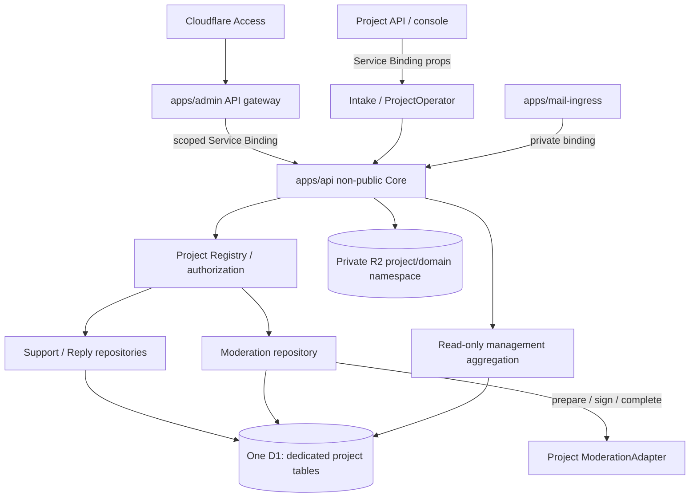

# Architecture

最終更新: 2026-10-15。調査結果・判断は [storage redesign](storage-redesign.md)、移行手順は
[Project storage](../operations/project-storage.md)。

## 境界と共通機能

3 Workerを維持する。CoreだけがD1 / R2を持つ。Coreはrouteもworkers.devも持たない。
gatewayはAccess JWTを再検証し、全/api/*をpermissionForで分類する。UIは利用側が持つ。
ProjectはIntake（受付・証跡・provider receipt）と、propsで範囲を固定したProjectOperator（自Projectの運用）を使う。
ProjectにAdminCoreやDBをbindしない。

認証・通知・監査記録機構・ファイル抽象・ID・日時・Zod検証・Result形式・冪等性・SDK・Bindingは共通。
本文を持つ業務表を共通化の境界にしない。署名や運営者名はBRANDING、Project設定はseed、
アプリ固有の措置はSIGNED_MODERATIONのadapterが与える。

## 保存先とRepository

appsがProjectの登録情報。servicesは分類・既定受付先の互換メタデータ。
project_storageはservice IDから検証済みtable prefix、schema version、copying/activeを選ぶRegistry。
実在の値はデプロイ側migrationに置く。slugをSQL識別子へ補間しない。

| 専用表suffix | 責務 |
| --- | --- |
| support_tickets / support_messages | 会話・返信先・本文・Support状態 |
| support_attachments / support_drafts | 添付参照・下書き |
| support_reply_sends / support_reply_attempts / support_redirects | 送信記録・provider key・旧IDの転送 |
| moderation_reports / moderation_events | 対象・理由・証跡テキスト・審査状態・処理結果・履歴 |
| moderation_evidence / moderation_operations | R2証跡参照・署名操作・リース・失敗コード |
| cases / case_sources / case_messages / case_events / case_reports / case_relations | 受付番号・担当・優先度・既存Ticket APIの互換表現 |

各Projectは上記17表を持つ。FKは同じprefix内の実表を指す。親レコードのProject所有者はDB triggerでも強制する。
casesはProject内の運用上の投影であり、複数Projectの本文を格納する共有tickets表ではない。
共通RepositoryのSQL語彙をProject Databaseが固定の実表へ解決するので、プロダクトごとのSQLコピーは不要。
管理一覧はアプリケーションが構成する読み取り専用CTE/UNIONで集約し、書き込みは必ず単一の保存先を選ぶ。
IDだけのAPIで所有者が一意でなければ拒否する。project_record_idsは不透明IDと所有者だけを予約し、ID衝突を拒否する。

共通表は設定・番号採番・通知device・監査メタデータ・delivery_jobs / delivery_progress。
配送jobに本文を載せない。本文は専用業務表または期限付きprivate R2。監査metadataはID・コード・件数だけ。
移行中は未切替Projectだけ旧表を使う。全切替後のsealでfallbackと旧表への書込を禁止する。

## 独立したライフサイクル

Supportは会話・担当・内部メモ・返信/下書き・解決/再開とSLAを持つ。
公開Ticketの既存status、type、TK番号、revisionは維持する。内部メモのサービスはmail providerを持たない。

Moderationの正はreports。open → reviewing → actioned/closed、closed → reviewingの専用遷移を持つ。
actionedは措置指示の公開・対応記録を表し、削除の実行確認とは区別する。
通報用caseではSupport SLAの違反を計算せず、一般Ticket APIで最終判定や再審査を行わせない。
会話の解決・返信・メール受信はModerationの判定を変えない。投稿時の自動チェックは別の処理。
異議申立ては将来Moderationの独立イベントとして追加できる。

署名必須Projectはadapter不通でも署名必須を維持する。prepare → 端末署名 → completeは維持し、
操作ID・2分のリース・単調増加revisionで重複/遅延完了を制御する。失敗は判定を確定せず同じ操作IDで再試行する。
署名必須Projectの汎用resolution編集も拒否する。

## 認可と外部契約

Binding propsが許可Projectを決める。ProjectOperatorの一覧は許可Projectの専用表だけを読む。
他ProjectのIDはNOT_FOUND。AdminCore scopeも一覧・個別操作・ファイル・監査に適用する。
同じgatewayで人物ごとに対象Projectを分ける場合は、ADMIN_CORE_ROUTESでAccess subjectからscope付きbindingへ対応させる。
設定時は未登録subjectを拒否し、リクエストからbindingを選ばせない。
Projectを跨ぐ移管・結合は専用移行として扱い、通常のTicket変更で実行しない。

権限は support:read/reply/manage、moderation:read/review/decide、platform:configure、audit:read。
viewerは両ドメイン閲覧、operatorは返信・Support運用・審査メモ、adminは設定と判定も持つ。
supportはSupportのみ、moderatorはModerationのみ。operatorにコンテンツ削除権限は与えない。
共通Ticket一覧は両ドメインの閲覧権限を持つrole向け。ドメイン専用roleは専用APIを使う。

既存SDKの受付・ProjectOperator公開契約は変更しない。旧ID、番号、簡易status、冪等キー、メール設定・署名は維持する。
SDKの依存固定tagを変える必要はない。未登録slugの問い合わせを既定Projectへ暗黙に保存する挙動は廃止。
正当な未分類受付はslug省略とallowUnassignedを明示する。

新R2キーはprojects/{opaque project ID}/{support|moderation}/...。
旧キーはDBのメタデータから読み、移動しない。メール原文journalは既存のproject/宛先hashにより分離し、30日保持を維持する。
通知はTicket番号・種別・アプリ名・リンクだけ。

D1の障害・容量・バックアップ・Time Travelは共有単位。テーブル分離は可用性分離ではない。
Projectごとの論理exportと復旧、段階移行、追加手順は[運用文書](../operations/project-storage.md)を参照する。
