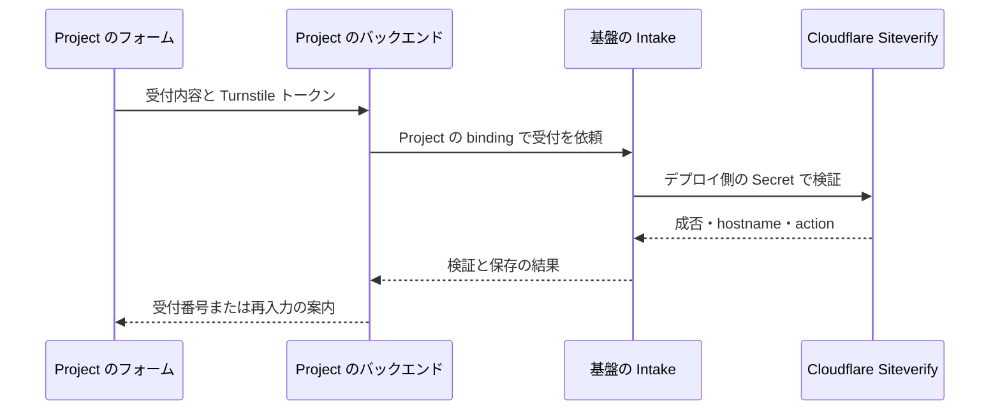

# 共通基盤の再設計案

問い合わせと通報を、それぞれ単独で導入できる業務機能として提供する。どちらも受付、チケット管理、利用者への返信を提供できる。状態と履歴は各機能が持ち、認可・監査・配送などの共通処理を共有する。基盤は API、SDK、必要に応じて MCP を提供する。公開フォームと管理画面は各 Project が実装する。

現行との差分は[機能棚卸し](capability-inventory.md)を参照。

実装の設定例は[デプロイ手順](../operations/deployment.md#サイトごとの機能選択)にある。既存環境は設定を省略して従来の受付・配送を続けられる。明示設定した Project の通報は独立した通報チケットとして作られる。現段階は既存の D1 スキーマを共有し、通報のメール会話にも既存のメール保存を使う。既存の通報やメール会話の物理的な再配置は後続の移行設計で扱う。

## 問い合わせと通報

| | 問い合わせ | 通報 |
| --- | --- | --- |
| チケットの正本 | 問い合わせチケット。件名、本文、問い合わせ元、対応履歴 | 通報チケット。対象、理由、報告者、証跡、審査履歴 |
| 基本操作 | 受付、一覧・詳細、内部メモ、対応状態の変更、解決・再開 | 受付、一覧・詳細、審査開始、審査メモ、判定、再審査 |
| 状態の意味 | 未対応、対応中、回答待ち、解決済みなど | 未審査、審査中、判定済みなど。判定結果と Project 側での措置の実行結果は別に記録 |
| 利用者への返信 | 問い合わせ元への回答。問い合わせの履歴に記録 | 報告者への連絡。通報の連絡履歴に記録。返信・受信と審査判定は独立 |

両方で受付 ID、表示番号、日時、履歴のページング、同時更新の競合検知を共通化できる。チケットには必ず Project と種別があり、保存先の選択・取得・更新に使う。種別ごとにコマンドと権限を持ち、通報の閲覧権限は問い合わせの閲覧権限から独立させる。横断一覧を提供する場合は、権限で絞り込んだ各機能の読み取り結果から作る。

通報の登録時に作るのは通報自身のレコードと審査履歴。報告者と連絡する場合にだけ通報の連絡履歴へメッセージを追加する。報告者の連絡先がなければ、その通報は審査と判定だけで完結する。メール配送に共通実装を使っても、メールの所有先とアクセス権は元のチケットに従う。

共通契約は Project の境界、入力検証、受付の冪等性、認可、監査、個人情報の保護とエラー形式。状態遷移、返信先の決め方、送信結果の意味など、各機能が約束する動作は全 Project で共通にする。

## 選んで使う機能

棚卸しに載せた現行機能は、対応する機能を選べば再設計後も使えるようにする。既存サイトでは有効な機能と設定値を移行して、切り替え前と同じ運用を続けられるようにする。

| 機能 | 必要な機能 | 提供すること |
| --- | --- | --- |
| 問い合わせ | 共通契約 | 受付とチケット対応 |
| 通報 | 共通契約 | 受付と審査・判定 |
| メール返信 | 問い合わせまたは通報、送信 adapter | チケットから利用者へ返信。宛先は記録済みの連絡先から基盤が解決し、送信状態を履歴に表示できる API を提供 |
| 自動受付メール | 対象機能と送信 adapter | 受付確定後に利用者に送る。問い合わせと通報で別々に有効化できる |
| 受信メール | 対象機能と受信 adapter | 既存のチケットに返信を取り込む。メールからの新規問い合わせ起票は明示して有効にする。通報の新規受付は通報 API で行う |
| 下書き・テンプレート・署名 | それぞれ対象機能 | 下書きの保存、文面の呼び出し、送信時の署名付与を個別に選べる。文面・署名・ロゴは Project またはデプロイ側が管理 |
| 添付・証跡 | 対象機能と非公開ストレージ | アクセス権と保持期限をチケットにひもづける |
| 運用者通知 | 対象機能と選んだ配送先 | 新着や配送失敗をメール・Push 等で知らせる。通知に載せるのは Ticket 番号・種別・Project 名・リンクのみ |
| 担当・分類・SLA・横断集計 | 対象機能 | 必要な運用機能を個別に有効化する。分類の値と SLA 目標は設定で渡す |
| Project 側の措置連携 | 通報と措置 adapter | 基盤に判定を記録し、Project 側に措置を依頼できる。署名必須の設定は Worker で強制し、adapter の実行結果を判定と分けて記録 |
| Turnstile | 対象の公開受付 | ブラウザから送られたトークンを基盤で検証する |

デプロイで利用可能な機能を選び、その範囲で Project と種別ごとに有効化する。Worker は機能の有効化と呼び出し元の権限を両方確認する。管理クライアントには、その呼び出し元が利用できる機能を返す。たとえば通報だけを導入する場合、問い合わせ用のテーブルやメール用の Secret・Cron を省ける。物理的には同じ Worker や D1 に置ける。分離は業務サービス・権限・保存先の責任から始める。

メール返信、自動受付メール、運用者通知は異なる操作として扱い、配送 adapter と再試行の仕組みを共有できる。配送が必要な操作は、メッセージや受付記録と配送予約を同時に保存する。受付結果と配送結果は別に返し、運用者は送信待ち・送信済み・失敗を追える。プロバイダーの応答が不明な場合は未確定として扱い、同じ送信キーでの照会・再試行を行う。新規メールとして送り直す操作とは区別する。

## サイトごとのメール設定

基盤は文面の差し込み、署名の付与、送信・再試行、返信の取り込みを共通機能として提供する。各サイト（Project）は問い合わせと通報それぞれについて、使う機能と設定値を選ぶ。たとえば同じ基盤で、あるサイトは独自の署名付きで受付メールを送り、別のサイトは自動送信を無効にして署名なしで手動返信できる。

| 機能 | サイトで設定できる項目 |
| --- | --- |
| 自動受付メール（一次受け） | 有効・無効、件名、本文、受付番号などの差し込み、署名の有無。問い合わせでは元の本文の引用や、運用者を含めたメールでの対応を選べる |
| 手動返信・下書き・テンプレート | 返信を有効にする対象、下書き保存、問い合わせ用・通報用の定型文、署名の有無。既存のスレッド維持と全員返信を使える |
| 署名と表示 | 署名文、締めの一文、ロゴ、署名の枠色。自動受付と手動返信で付けるかを個別に選べる |
| 配送・通知 | 差出人の表示名とアドレス、返信先、送信 adapter と資格情報の参照、受信経路、通知先と管理画面リンク |

サイトが設定した文面と配送経路を使う。共通の初期文面や設定を使うサイトは、その継承を明示できる。設定が欠けている場合は管理側に知らせ、他サイトの差出人・署名・資格情報へ切り替わる経路を作らない。既存サイトがデプロイ共通の設定を使っている場合は、移行時にその継承も引き継ぐ。表示情報・署名・ロゴはデプロイの `BRANDING` で与え、運用データと配送先はデプロイ側の設定で管理する。資格情報は Secret に置く。

自動受付メールは、対象となる新規受付が確定し、連絡先があるときに一度だけ送信を予約する。再送や配送再試行でも別の受付メールを増やさず、担当者の初回返信とは別に履歴へ記録する。手動返信は元のチケットに記録し、受信返信も同じチケットに戻せる。利用者向けの受付メールと運用者への新着通知は個別に設定する。 [現行のメール運用](../operations/deployment.md#問い合わせの受付メール)

## API と MCP

| 利用者 | 入口 | 例 |
| --- | --- | --- |
| 各 Project の公開フォームやアプリ | Project のバックエンド → SDK → `Intake` | `submitContact`、`submitReport`。binding で Project と許可操作を決める。受付結果は受付 ID、表示番号、重複の有無 |
| 管理画面・CLI | 認証済みの運用 API | `/api/inquiries` の一覧・詳細・状態変更・返信、`/api/reports` の一覧・詳細・審査・判定・返信 |
| MCP クライアント | 任意で導入する認証済み MCP | 問い合わせ一覧、通報詳細などを、運用 API と同じ認可・監査を通る操作として公開 |

パスと操作名は設計例。既存の Project 管理画面が利用する `ProjectOperator` は互換窓口として扱う。Project の受付や連携は `Intake` を通し、`AdminCore` の binding は基盤内に置く。新しい運用ルートは `permissionFor` で分類し、設定書き込みは `CONFIGURATION_PATHS` に加える。MCP に書き込みを公開する場合も、同じ操作者・Project・機能・操作権限で判定し、同じ操作結果と監査を残す。初回の MCP は一覧・詳細から始める案とする。

## Turnstile

基盤側で検証できる。各 Project は自分の画面に公開 sitekey を使ってウィジェットを埋め込み、取得したトークンを受付リクエストと一緒に自分のバックエンドから `Intake` へ渡す。基盤はデプロイ側で設定した Secret を使って Cloudflare の Siteverify を呼ぶ。 [Cloudflare の導入手順](https://developers.cloudflare.com/turnstile/get-started/)

- Project と受付種別ごとに、許可する hostname と期待する action、Secret の参照を設定する。基盤は binding と操作から検証設定を選び、Siteverify の成功と hostname・action の一致を確認する。検証必須の入口はトークンの欠落・不正・検証サービスの障害を区別して返す。サーバー間の受付が必要なら、公開フォームとは別の binding 権限で許可する。 [Cloudflare のサーバー検証](https://developers.cloudflare.com/turnstile/get-started/server-side-validation/)・[ウィジェットのホスト名設定](https://developers.cloudflare.com/turnstile/additional-configuration/hostname-management/)
- トークンは有効期間が 5 分で、近いタイミングの再検証が成功することがある。厳密に一つの新規受付に限定するため、基盤は生トークンの代わりに短期保持のダイジェストを使い、受付と同時に一意に記録する。同一 Project・呼び出し元・受付種別で、同じ受付キーと入力に対する確定済みの再送は既存の受付結果を返す。受付が未確定でトークンが失効した場合は、画面で新しいトークンを取得して同じ受付キーで再送できる。 [Cloudflare のトークン有効期限と再利用の説明](https://developers.cloudflare.com/turnstile/get-started/server-side-validation/#token-reuse-and-network-convergence)

## 既存環境からの移行

1. 既存の Project ごとに、受付・返信・自動メール・受信・通知・テンプレート・署名・措置連携の実際の利用を確認する。その結果から初期の有効化設定を作る。
2. 新しい問い合わせ・通報の保存先を追加する。通報にひもづく既存 Support スレッドは通報側の連絡履歴として引き継ぎ、問い合わせ一覧には重ねて出さない。元の ID、表示番号、状態、監査、添付参照、配送済み Message-ID、未完了の配送と再送キーの対応を検証する。帰属が一意に決まらないデータは切替前に個別確認する。
3. Project 単位で書き込み先を一つに決めて切り替える。既存の受付・管理 API は互換経路で新しい業務サービスを呼ぶ。移行は追加と前進修復で進め、SDK 契約を更新するときは新しいタグを発行する。

## 実装順と確認する動作

1. 問い合わせだけ、通報だけの各構成で、受付・一覧・詳細・基本操作を通す。通報の受付から問い合わせのレコードや配送ジョブが作られず、各種別の権限で他方のデータにアクセスできないことを確認する。
2. 両方に共通のメール配送をつなぐ。通報への返信が通報の連絡履歴に残り、審査状態を変えないことを確認する。異なる設定の二つのサイトで、受付メールの有効・無効、件名・文面・署名・送信経路、手動返信、再送時の重複防止を確認する。
3. 公開受付で Turnstile を有効にし、未検証の新規受付を拒否できることと、受理済みリクエストの再送で同じ受付結果が返ることを確認する。
4. 既存データと API の互換経路を検証する。MCP は、業務 API の権限と操作が固まった範囲から追加する。
